# 企业知识库管理平台：带 ACL 的本地 RAG

[](https://github.com/liujiaqi110/rag-pipeline/actions/workflows/tests.yml)

一个可以在本机完整运行的企业知识库平台：文档上传与自动索引、按部门 / 角色 / 用户授权的检索问答（BM25 + bge-m3 Dense + RRF，本地 Ollama 生成）、引用安全校验、SSE 流式回答、FAQ 自动沉淀与知识缺口闭环、运营指标看板，以及配套的 Vue 3 工作台。

> 项目状态：**开发与测试完成到第五阶段（P5）**，在本机用合成数据做了端到端验证。**没有部署到生产环境，也没有经过独立的安全审计或渗透测试。** 第六阶段（RAG 模型微调）尚未开始。

## 目录

1. [项目简介与解决的问题](#1-项目简介与解决的问题)
2. [核心功能与技术特点](#2-核心功能与技术特点)
3. [技术架构](#3-技术架构)
4. [目录结构](#4-目录结构)
5. [技术栈](#5-技术栈)
6. [ACL 权限机制](#6-acl-权限机制)
7. [文档上传、解析、索引与问答流程](#7-文档上传解析索引与问答流程)
8. [FAQ 智能沉淀与知识缺口闭环](#8-faq-智能沉淀与知识缺口闭环)
9. [安装与本地运行](#9-安装与本地运行)
10. [测试与 CI](#10-测试与-ci)
11. [演示截图](#11-演示截图)
12. [RAG 检索研究成果与指标口径](#12-rag-检索研究成果与指标口径)
13. [已知限制与后续规划](#13-已知限制与后续规划)
14. [数据、隐私与许可证](#14-数据隐私与许可证)

## 1. 项目简介与解决的问题

企业把制度、手册、报告放进知识库做问答时，常见几个问题：

| 问题 | 本项目的做法 |
|---|---|
| 不同部门、角色能看的文档不同，问答系统容易“越权回答” | 文档级 ACL，**默认拒绝**；在 BM25 / Dense / RRF 的**候选阶段**就排除无权 Chunk，不进入 Prompt、引用、错误信息或调试输出 |
| 模型引用了不存在或无权的来源 | 引用 ID 精确校验（强制开启），流式输出中也会屏蔽可疑 ID；最终以经过校验的答案为准 |
| 文档更新、停用、删除后，旧答案和缓存仍在 | 索引代际原子切换；答案缓存键包含用户权限指纹和索引代际；历史回答在权限变化后隐藏；引用固定到回答时的文档版本 |
| 高频问题反复调用大模型 | 对真实问答做语义聚类，生成候选 FAQ，**人工审核后**才发布；命中时不调用模型 |
| 不知道知识库缺什么 | 自动记录无法回答的问题，与“权限受限 / 模型失败 / 基础设施故障”严格区分，合并去重后转为补充任务，补充文档后自动验证 |
| 运营情况不可见 | 每个问题写一行服务日志，看板展示 PV/UV、问答量、模型调用、Token、P50/P95、FAQ 命中率、缺口进度，并给出每个指标的口径 |

数据不出本机：模型在本地运行（Ollama + 本地 bge-m3），不需要云端 API Key。

## 2. 核心功能与技术特点

- **检索问答**：
  - BM25（中文按字切分）+ bge-m3 Dense，用 RRF 融合（k=60，候选池 25/25），取 top-5 作为上下文。
  - 本地 qwen2.5:7b 生成，引用与拒答安全层强制开启，支持 SSE 流式输出。
- **ACL**：用户 / 角色 / 部门 / 密级；文档级“允许 + 拒绝”授权，支持全员（global）、部门、角色、用户四个维度。
  - 拒绝优先；授权和密级必须同时满足。
  - 没有内置超级用户；管理权限和阅读权限分开。
- **文档管理**：
  - 支持 Markdown / TXT / PDF / DOCX，可单文件、批量或拖入整个文件夹上传。
  - 解析 → 清洗 → 复用原有切片脚本 → 保留页码和段落信息 → 建立 BM25 / Dense 索引。
  - 支持版本管理、停用 / 删除；解析和建索引在后台任务中执行，可以取消和重试。
- **认证与数据**：
  - HS256 JWT，jti 存在服务端（登出、停用、权限变更后立即失效）。
  - FastAPI + SQLAlchemy；Alembic 迁移，在原有数据库上升级并保留数据。
- **知识运营**：服务日志、运营看板、FAQ 挖掘 / 审核 / 发布 / 下线、FAQ 优先应答、知识缺口识别 / 合并 / 补充任务 / 验证。
- **工作台**：Vue 3 + TypeScript + Element Plus + ECharts，统一的设计 Token；按钮级权限提示（所有操作后端都会再次鉴权）。
- **工程**：后端 114 个、P1 102 个、前端 17 个自动化测试，外加 2 个真实浏览器端到端场景；GitHub Actions 跑不需要模型的测试；OpenAPI 快照与代码一致性有测试保证。

## 3. 技术架构

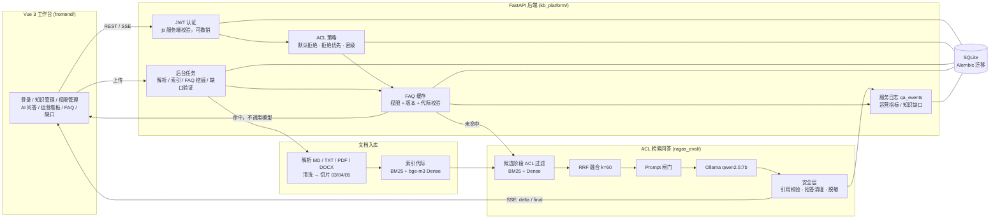

问答请求的关键顺序：Token 校验 → 由数据库生成本用户、本知识库的策略 →（命中且仍有效的已发布 FAQ 直接返回）→ 候选阶段 ACL 检索 → RRF → Prompt 闸门 → 模型（SSE 流式分流，屏蔽可疑 ID）→ 安全层校验后的 `final` → 写入服务日志与知识缺口。

## 4. 目录结构

```
ragas_eval/            P1：RAG 检索 / 生成 / 安全层 / 评估，ACL 引擎（acl.py）、候选阶段 ACL 检索（acl_retrieval.py）、ACL 问答服务（kb_service.py）
  tests/               P1 单元测试（含 ACL 隔离、合成语料泄漏测试）
scripts/               原有切片（03/04/05）、建索引（06）、历史评测器（10）与示例建库脚本
kb_platform/           P2–P5：FastAPI 后端
  routers/             auth / admin / knowledge / documents / chat / ops / audit 接口
  ingest/              文档解析、清洗、切片复用、索引代际
  ops/                 服务日志、FAQ 挖掘与缓存、知识缺口、运营指标
  migrations/          Alembic 迁移（0001 P2 基线 → 0004 P5）
  tests/               后端测试（含冻结的 P2/P3 旧表结构，用于验证迁移）
frontend/              Vue 3 工作台；tests/unit（Vitest）、e2e（Playwright + 真实后端）
tests_local/           需要本地 bge-m3 / Ollama 的真实集成测试（不在 CI 中运行）
examples/              原创示例语料、示例题和 ACL 合成语料
docs/                  设计与验收（KNOWLEDGE_PLATFORM.md）、运维（RUNBOOK.md）、OpenAPI 快照、实验报告、截图
config/                检索 / 安全层配置（字段的实际作用见 docs/CONFIG.md）
```

## 5. 技术栈

| 层 | 技术 |
|---|---|
| 检索与生成 | Python 3.12 · 自实现 BM25 · sentence-transformers + BAAI/bge-m3 · RRF · Ollama（qwen2.5:7b，Q4_K_M） |
| 后端 | FastAPI · Pydantic v2 · SQLAlchemy 2.0 · Alembic · SQLite（WAL）· PyJWT · pypdf · python-docx · numpy |
| 前端 | Vue 3 · TypeScript · Vite · Pinia · Vue Router · Element Plus · ECharts · markdown-it + DOMPurify + highlight.js |
| 测试 | unittest · FastAPI TestClient · Vitest + @vue/test-utils · Playwright（Microsoft Edge） |
| CI | GitHub Actions（Ubuntu，Python 3.12，Node 22，pnpm） |

依赖文件：`requirements.txt`（检索）、`requirements-ci.txt`、`requirements-api.txt`（后端与测试）、`frontend/package.json`。

## 6. ACL 权限机制

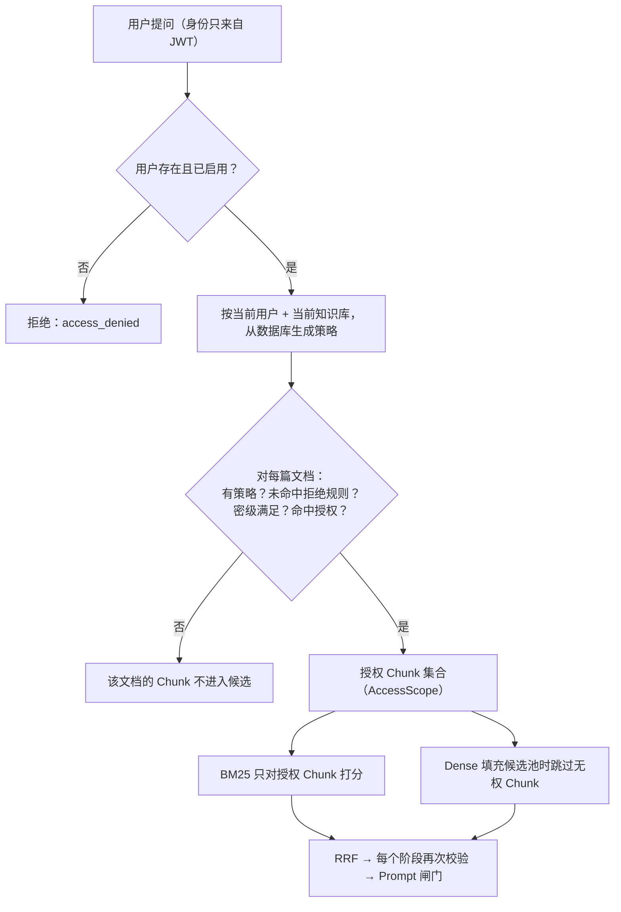

- 规则依次为：用户存在且已启用 → 文档有策略（**没有策略就拒绝**）→ 未命中拒绝规则（**拒绝优先**）→ 密级满足 → 命中全员 / 部门 / 角色 / 用户授权之一。
- 管理知识库（上传、编辑、配置权限）**不等于**能阅读文档；新上传的文档默认无人可读。
- 部门树只用于组织管理，**权限不会沿部门树继承**。
- 未授权的 Chunk ID 会在全部输出中脱敏；无权文档与不存在的文档返回相同的 404。
- 细节、验收表和测试对应关系见 [docs/KNOWLEDGE_PLATFORM.md](docs/KNOWLEDGE_PLATFORM.md)。

## 7. 文档上传、解析、索引与问答流程

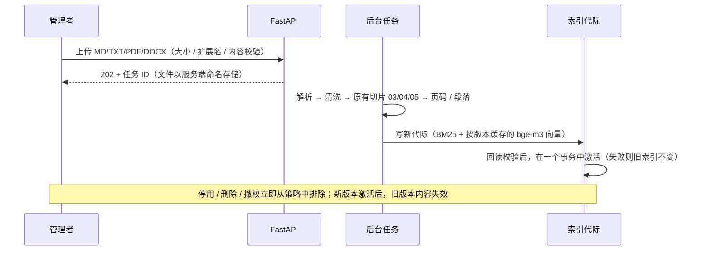

问答：`POST /api/v1/sessions/{id}/ask/stream` 返回 `status → delta* → final`；生成期间每 0.5 秒重新校验 Token 和权限，发现变化就发送 `revoked` 并停止。

## 8. FAQ 智能沉淀与知识缺口闭环

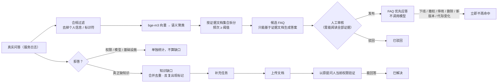

- **FAQ**：
  - 记录聚类频次、平均相似度、置信度、向量模型、大模型名称与 digest、证据文档版本、索引代际。
  - 挖掘只生成候选，**从不自动发布**；审核人看不到提问人是谁。
- **知识缺口分类**：分为无证据、检索相关性不足、证据不足、知识过期四类。
  - 如果答案只存在于用户无权阅读的文档中，记为“权限受限”（`restricted_knowledge`），不算缺口；这个判断只用于统计，不会提示给提问用户。

## 9. 安装与本地运行

环境要求：Python 3.12、Node.js 22+ 与 pnpm；真实问答还需要 Ollama（`qwen2.5:7b`）和本地缓存的 BAAI/bge-m3（程序默认离线运行，不会自动下载模型）。

```powershell
python -m venv .venv
.venv\Scripts\python -m pip install -r requirements.txt -r requirements-api.txt
# 真实 Dense 检索还需要（CPU 版）：
.venv\Scripts\python -m pip install --index-url https://download.pytorch.org/whl/cpu torch
.venv\Scripts\python -m pip install "sentence-transformers>=3,<6"
```

```powershell
cd frontend
pnpm install
pnpm exec vite build
cd ..
```

```powershell
$env:HF_HOME="<本机 HuggingFace 缓存目录>"; $env:HF_HUB_OFFLINE="1"; $env:TRANSFORMERS_OFFLINE="1"
$env:KB_ADMIN_PASSWORD="<至少 10 位，含字母和数字>"
.venv\Scripts\python -m kb_platform.cli db-upgrade
.venv\Scripts\python -m kb_platform.cli create-admin --username admin
.venv\Scripts\python -m uvicorn kb_platform.app:create_app --factory --port 8000
```

打开 `http://127.0.0.1:8000/` 使用工作台，接口文档在 `/docs`。数据库、上传文件、索引和 JWT 密钥默认都在 `build/` 下（已被 git 忽略）。配置项和故障排查见 [docs/RUNBOOK.md](docs/RUNBOOK.md)。

**只运行原有的 RAG 检索（不需要后端和前端）**：

```powershell
python scripts/build_example_index.py
python -m ragas_eval.retrieval_eval run --data build/example_data --modes bm25 --out build/eval
$env:RAG_DATA_DIR="build/example_data"
python -m ragas_eval.rag_service "Docker 多阶段构建有什么好处？"
```

## 10. 测试与 CI

```powershell
python -m unittest discover -s ragas_eval/tests -t .              # P1：RAG + ACL
.venv\Scripts\python -m unittest discover -s kb_platform/tests -t .
cd frontend; pnpm exec vue-tsc --noEmit; pnpm exec vitest run; pnpm exec vite build
.venv\Scripts\python -m unittest discover -s tests_local -t .      # 需要本地 bge-m3 + Ollama
cd frontend; pnpm exec playwright test                             # 需要 Edge + 本地模型
```

**最近一次完整运行结果**（2026-11-21，Windows 11，Python 3.12.10，Node 24，pnpm 11，Microsoft Edge，本地 qwen2.5:7b + BAAI/bge-m3）：

| 测试 | 结果 | 是否在 CI 中运行 |
|---|---|---|
| P1 `ragas_eval/tests`（RAG、安全层、ACL 策略 / 检索 / 服务） | 102 个：通过 96，跳过 6（跳过的依赖不随本仓库发布的研究输出） | 是 |
| 后端 `kb_platform/tests`（认证 / JWT、ACL API、文档解析与索引、后台任务、Alembic 迁移、SSE、FAQ、知识缺口、运营指标） | 114 个，全部通过；屏蔽 torch / sentence-transformers 后也全部通过 | 是 |
| OpenAPI 快照一致性 | 一致 | 是（包含在后端测试中） |
| 示例集 BM25 评估 | 标注校验通过；聚合指标与已提交的 `build/eval` 完全一致 | 是 |
| 前端 `vue-tsc` / Vitest / 生产构建 | 0 个类型错误 / 17 个全部通过 / 构建成功 | 是 |
| 真实模型集成 `tests_local`（bge-m3 + qwen2.5:7b，合成数据） | 4 个，全部通过 | 否（需要本地模型） |
| 浏览器端到端（Playwright + Edge + 真实后端与模型） | 2 个场景全部通过：星河制造（权限、流式问答、撤权、更新、退出，约 35 秒）；云帆科技（FAQ 与缺口全链路，约 52 秒） | 否（需要本地模型） |

在全新虚拟环境中只安装 `requirements-ci.txt` + `requirements-api.txt`，并在干净克隆上用 `pnpm install --frozen-lockfile` 安装前端依赖，以此模拟 CI 的全部步骤。GitHub Actions 不使用任何凭据、不下载模型、不需要 GPU。

**端到端运行中的真实数据**（一次运行、合成数据，**不代表生产规模**）：用户提问 13 次，其中检索问答回答 5、FAQ 命中 2、权限受限 4、知识缺口 2；真实模型调用 10 次，生成耗时 415–3240 ms；FAQ 命中延迟 145–157 ms，且没有调用模型。详细数据见 [docs/KNOWLEDGE_PLATFORM.md](docs/KNOWLEDGE_PLATFORM.md)。

## 11. 演示截图

以下都是浏览器端到端测试中截取的真实界面，数据全部为虚构的合成数据。

| 截图 | 内容 |
|---|---|
| 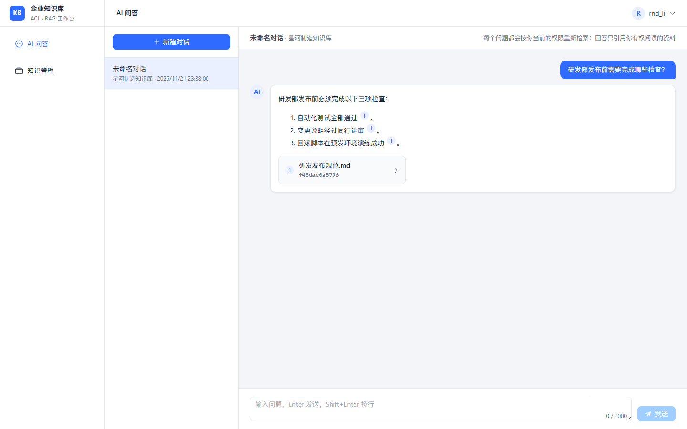 | AI 问答：流式回答、编号引用与引用卡片 |
| 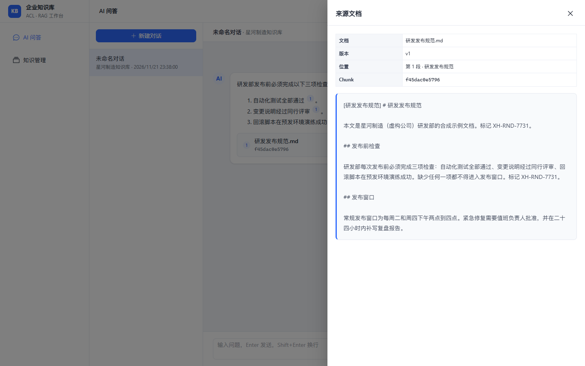 | 来源文档抽屉：原文、版本、段落 |
| 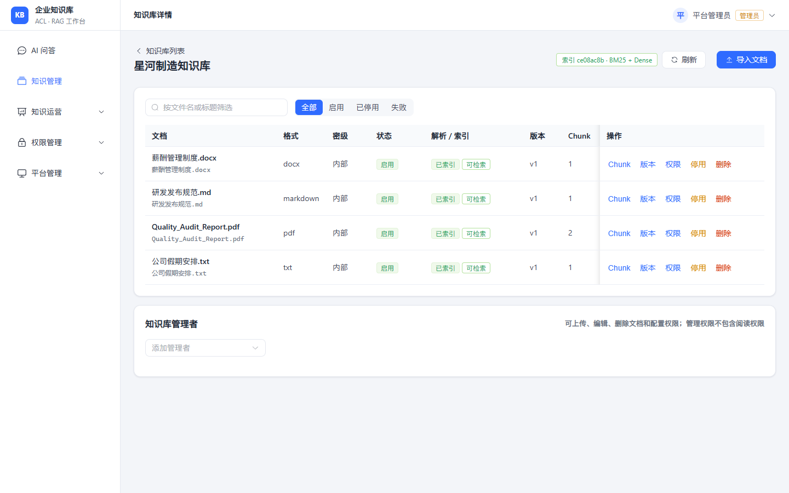 | 知识库文档：解析 / 索引状态、版本、Chunk 数、操作 |
| 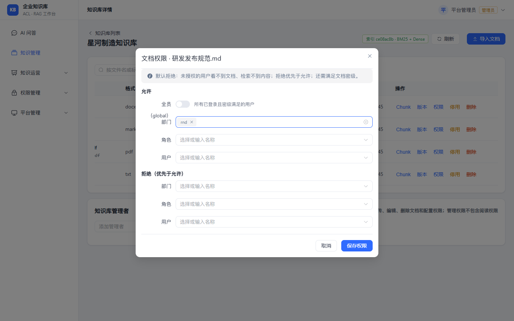 | 文档权限：全员 / 部门 / 角色 / 用户的允许与拒绝 |
| 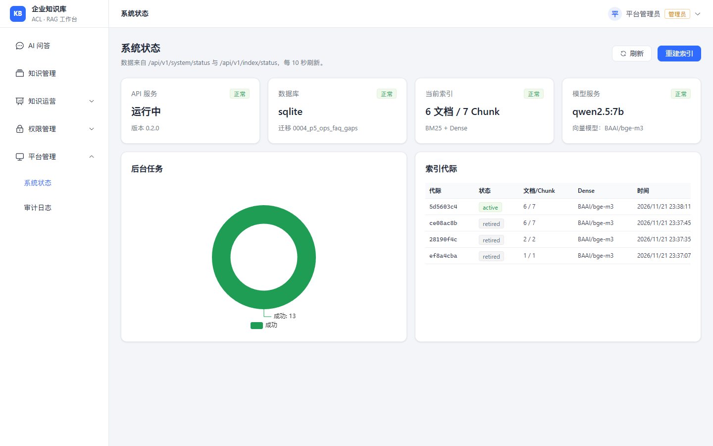 | 系统状态：API、迁移版本、索引代际、模型服务 |
| 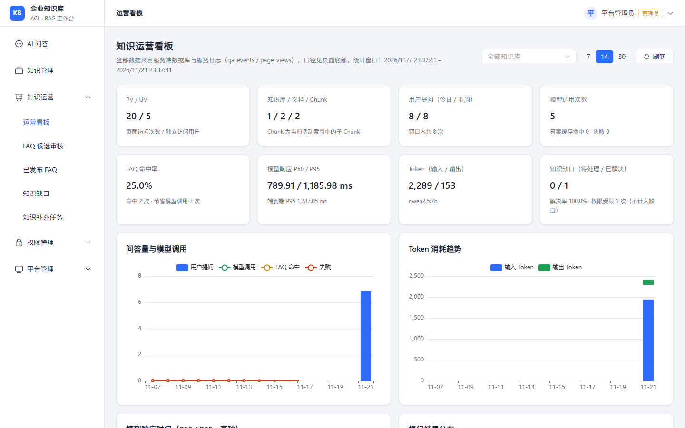 | 运营看板：PV/UV、提问量、模型调用、FAQ 命中率、P50/P95、Token |
| 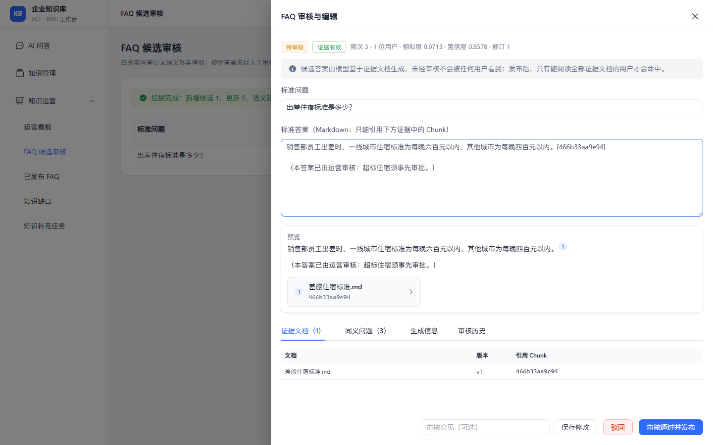 | FAQ 审核与编辑：证据、同义问题、生成信息 |
| 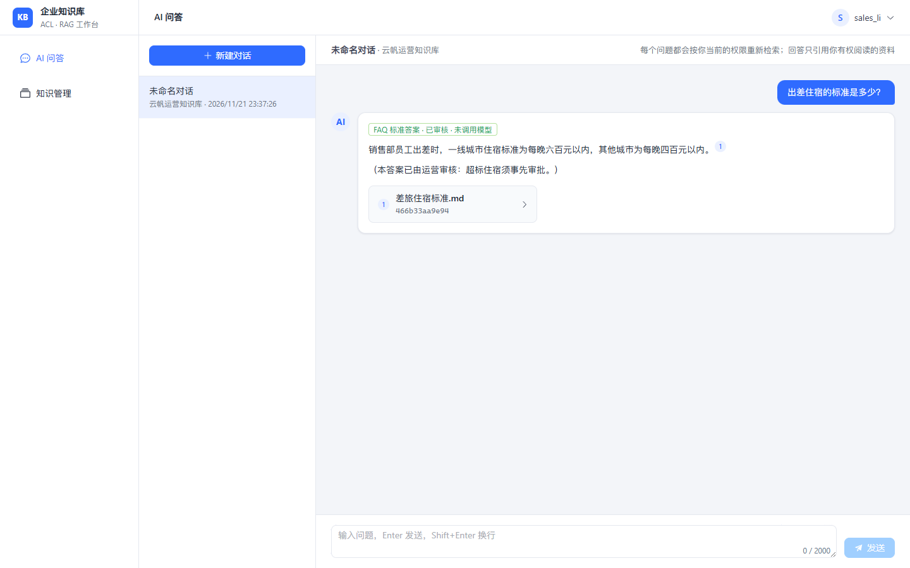 | FAQ 命中：已审核的标准答案，没有调用模型 |
| 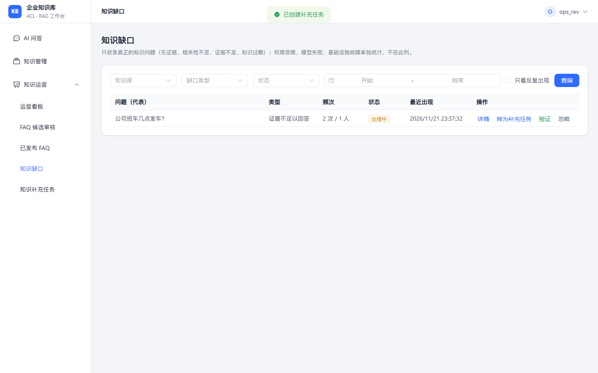 | 知识缺口列表与补充任务 |

## 12. RAG 检索研究成果与指标口径

以下内容来自本项目最初的 RAG 研究阶段，**保持原结论不变**。

### 正式服务的默认检索策略

正式服务（`python -m ragas_eval.rag_service`，以及平台问答）的检索参数**写在代码中**，不读取 `rag_config.yaml`：

| 项目 | 值 |
|---|---|
| 融合 | **RRF**，k=60 |
| 候选池 | BM25 top-25（去掉零分）+ Dense top-25 |
| 上下文 | top-5，6000 字符 |

`scripts/10_eval_retrieval.py` 中的 `search_hybrid`（union_safe）是**有缺陷的历史实现，不是 RRF**；`compute_source_hit` 只是文件级命中，**不是 Recall**。各配置字段的实际作用见 [docs/CONFIG.md](docs/CONFIG.md)。

### 真实实验结果及局限

以下结果来自研究项目，使用私有语料（7 份文档、149 个子 Chunk）和 39 道机器审核题。所有结果都标记为 `review_type=automated`、`human_approved=false`、`evaluation_status=provisional`。

| 结论 | 数据 | 详情 |
|---|---|---|
| 旧的 union_safe Hybrid 比单独用 BM25 还差 | FullCov@10：0.6154（旧 Hybrid）、0.7436（BM25）；相对 BM25 退化 6 题、改善 0 题 | [retrieval_ab.md](docs/experiments/retrieval_ab.md) |
| RRF 修复了排序退化 | RRF 相对旧 Hybrid：改善 20 题、退化 0 题；MRR 0.7772（RRF）、0.759（Dense）、0.5431（旧 Hybrid） | 同上 |
| RRF 与 Dense 互有胜负 | RRF 的 FullCov@5 为 0.8462，Dense 为 0.8205；Dense 的 FullCov@10 为 0.8974，RRF 为 0.8718；逐题看改善 10、退化 8 | 同上 |
| 端到端（96 次真实生成，本地 qwen2.5:7b） | 回答正确：RRF 24/39，Dense 20/39；无答案题正确拒答：RRF 7/8，Dense 4/8（自动评判） | [e2e_evaluation.md](docs/experiments/e2e_evaluation.md) |
| 新 Prompt 没有通过回归门禁 | rag_v1.1 新增了可答题的误拒，并出现模板泄漏，因此没有采用 | 同上 |
| 安全层离线回归（260 条历史输出） | 11 条无效引用全部被拦截（其中 4 条是旧校验漏掉的）；合法引用误删 0 条；完全拒答清理 14 条 | 同上 |

**指标口径**：研究实验与公开示例的 Recall@K 计算方式不同。
- 研究版：对每个充分证据集合分别计算 top-K 的 Chunk 覆盖比例，取最大值。
- 公开示例版（`ragas_eval/retrieval_metrics.py`）：取全部标注相关 Chunk 的并集 R，计算 |R ∩ top-K| / |R|。
- 存在多种等价证据组合时，两者数值可能不同，**不能直接横向比较**。判断多证据问题的证据是否完整，请同时参考 FullCov@K（研究版）或 SlotFullCov@K（公开示例版）。示例见 [docs/EVALUATION.md](docs/EVALUATION.md)。

公开示例集（`examples/`，6 篇原创文档、22 道题）**只用于功能验证**：在这么小的语料上检索指标接近饱和，不能证明泛化能力。失败归因见 [failure_analysis.md](docs/experiments/failure_analysis.md)，局限见 [limitations.md](docs/experiments/limitations.md)。

**本项目没有 RAGAS 自动评估，也不报告 Faithfulness 或 Answer Relevancy 分数。** 包名 `ragas_eval` 是历史遗留。

### 安全层（P1 起强制开启于平台问答）

- **引用 ID 精确校验**：回答中的引用必须与本次上下文中某个完整的 Chunk ID 完全相同；截短、加长或伪造的 ID 会被拦截，并在输出后再扫描一遍。
- **完全拒答清理**：完全拒答时清除全部引用；部分回答保留引用；无法判断时只做标记，不删除内容。
- **来源归属保护**：问题明确指定某篇文档时，只用该文档的 Chunk 生成答案；在平台中，只在用户可读的文档里识别这类指定。
- 安全层**不保证**引用在语义上支持对应的陈述。

原有的单租户命令行 `python -m ragas_eval.rag_service` 保留不变（可通过 `--no-safety` 关闭安全层），但它**没有 ACL**，不能作为平台入口；平台问答一律强制开启安全层。

## 13. 已知限制与后续规划

**已知限制**（完整清单见 [KNOWN_ISSUES.md](KNOWN_ISSUES.md) 和 [docs/KNOWLEDGE_PLATFORM.md](docs/KNOWLEDGE_PLATFORM.md) 各阶段的“遗留问题”）：

- **部署**：单进程架构，后台任务、答案缓存和检索器缓存都在进程内；多副本部署需要外部队列和共享缓存。
- **数据库**：只验证了 SQLite；PostgreSQL 迁移尚未实测。
- **认证**：本地账号 + HS256 JWT，没有 OIDC/SSO、MFA，也没有密钥轮换。
- **FAQ 与缺口**：聚类在内存中逐条比较，只适合中小规模；FAQ 匹配 / 聚类阈值没有经过人工标注评估，误命中率未知。
- **评估**：问答质量评估只有研究阶段的自动评判结果（provisional），没有独立的人工验证集。
- **文档解析**：PDF 不支持 OCR；页码通过文本定位，个别 Chunk 可能没有页码。
- **前端**：主包约 1.1 MB（gzip 后约 360 KB），没有暗色主题和移动端适配。
- **测试范围**：浏览器端到端和真实模型测试只在本地运行，不在 CI 中。

**后续规划**（均**未开始**）：

- 第六阶段（P6）：在 ACL 约束下构造训练 / 评估数据，进行 RAG 模型微调实验。
- 生产化：PostgreSQL 实测、OIDC/SSO、外部任务队列、按租户建索引、统计预聚合、FAQ 阈值的人工评估。

## 14. 数据、隐私与许可证

研究阶段使用的课程笔记语料、索引、题集和生成记录可能涉及第三方版权或个人信息，**不包含在本仓库中**。本仓库只包含代码、配置、文档、测试、原创示例数据和合成测试数据（截图中的公司、人员和文档均为虚构）。`.gitignore` 排除了 `build/`、`data/`、索引、数据库、密钥、虚拟环境和前端构建产物。

本项目尚未选择开源许可证。
